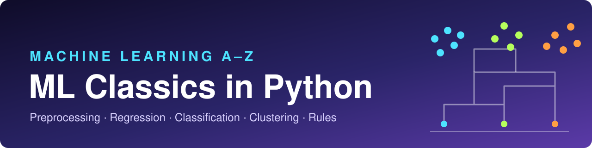
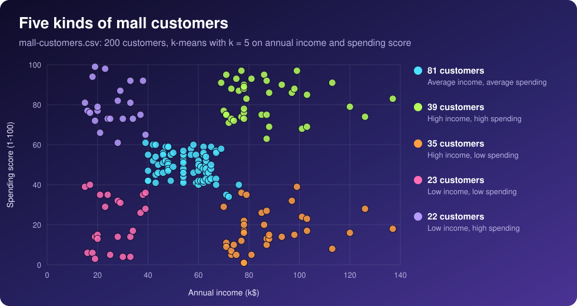
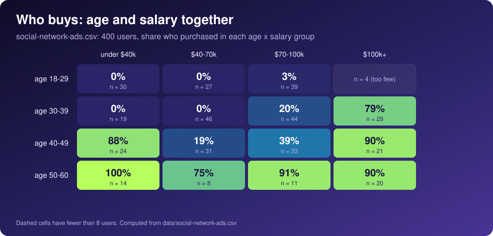

<p align="center">
  <a href="https://www.python.org/"></a>
  <a href="https://scikit-learn.org/"></a>
  <a href="https://pandas.pydata.org/"></a>
  <a href="https://rasbt.github.io/mlxtend/"></a>
  <a href="https://jupyter.org/"></a>
  <a href=".github/workflows/notebooks-check.yml"></a>
  
  
</p>

The classic machine learning toolbox in **19 Jupyter notebooks**: preprocessing, six regression models, nine classification notebooks, two clustering methods and association rules. Each notebook loads a small dataset, fits the model, measures it and plots the result, with the reasoning in the comments. This is the Python twin of [ML-Classics-in-R](https://github.com/evgeniimatveev/ML-Classics-in-R).

> *"Learn by trying every algorithm on real data: 19 notebooks, 2,569 lines of annotated Python, eight datasets in use."*

---

## Course map

| # | Section | Notebooks | What you work on |
|:-:|---------|:---------:|------------------|
| 00 | [Quickstart](00-quickstart/) 🎯 | 1 script | Project overview |
| 01 | [Data Preprocessing](01-data-preprocessing/) 🧼 | 1 | Missing values, encoding, split, scaling |
| 02 | [Regression](02-regression/) 📈 | 6 | Linear, polynomial, SVR, tree and forest regression |
| 03 | [Classification](03-classification/) 🎯 | 9 | Nine classifiers on one dataset, then tuning |
| 04 | [Clustering](04-clustering/) 🧩 | 2 | k-means and hierarchical clustering of mall customers |
| 05 | [Association Rule Learning](05-association-rule-learning/) 🛒 | 1 | Apriori and FP-Growth on grocery baskets |

---

## Learning path

```
 Preprocessing ──► Regression ───────► Classification ──────► Clustering ──► Association Rules
   clean + scale     linear → poly       logistic → SVM        k-means        Apriori
   split data        tree, forest        Naïve Bayes, trees    hierarchical   FP-Growth
                                         KNN, RF, GB + tuning
```

First learn to prepare data, then predict a number (regression) and a category (classification), then find structure without labels (clustering, association rules).

---

## What the data says

Both charts are computed from the CSV files in [`data/`](data/).



The mall data (200 customers) has no labels, so clustering has to find the structure: five groups appear when customers are placed by income and spending. The segment names in the chart are descriptions I derived from each group's average, they are not part of the data. The k-means notebook picks k = 5 itself with the silhouette score.



In the Social Network Ads data (400 users) age matters most: nobody under 40 with a salary below $70k bought, while users aged 50 and over bought almost regardless of salary. Section 3 teaches nine ways to learn exactly this boundary.

---

## Scoreboard: which classifier wins?

Numbers saved in `03-classification/09-tuning-and-cross-validation-gb-rf`, after grid-search tuning, on a 30% test split.

| Model (tuned) | Test accuracy | Precision | Recall | F1 | ROC-AUC | CV accuracy |
|---|--:|--:|--:|--:|--:|--:|
| **KNN** | 0.9417 | 0.9000 | 0.9574 | 0.9278 | 0.9445 | 0.7675 |
| **Gradient Boosting** | 0.9250 | 0.9318 | 0.8723 | 0.9011 | 0.9156 | 0.8525 |
| **Random Forest** | 0.9083 | 0.8913 | 0.8723 | 0.8817 | 0.9019 | 0.8600 |

**KNN looks best on the test split (0.9417 accuracy) but has the lowest cross-validated accuracy (KNN: 0.7675).** The test split is only 120 users, so one lucky split flatters a model. With more folds (`cv=45`, as printed in the notebook) the picture is clear: KNN 0.7954, Gradient Boosting 0.9080, and the notebook concludes **Gradient Boosting** is best (0.9080). The lesson: judge a model by cross-validation, not by one split.

<details>
<summary>📈 Sample from <code>04-clustering/01-k-means-clustering.ipynb</code></summary>

```python
# 📌 Step 5: Auto-selection of best hyperparameters

# ✅ Auto-tune `n_clusters` for K-Means (Elbow Method + Silhouette Score)
best_k, best_silhouette = None, -1  # Initialize best cluster count and silhouette score
for k in range(2, 10):  # Iterate over potential cluster counts from 2 to 9
    kmeans_test = KMeans(n_clusters=k, init='k-means++', random_state=42)  # Initialize K-Means model
    labels = kmeans_test.fit_predict(X_pca)  # Fit model and predict cluster labels
    score = silhouette_score(X_pca, labels)  # Compute silhouette score for cluster quality evaluation
    if score > best_silhouette:  # If silhouette score improves, update best parameters
        best_k, best_silhouette = k, score
print(f"🔍 Best K for K-Means: {best_k} (Silhouette Score: {best_silhouette:.4f})")  # Print best cluster count

# ✅ Auto-tune `n_components` for GMM using Silhouette Score
best_gmm_k, best_gmm_silhouette = None, -1  # Initialize best GMM cluster count and silhouette score
for k in range(2, 10):  # Iterate over potential cluster counts from 2 to 9
    gmm_test = GaussianMixture(n_components=k, covariance_type='full', random_state=42)  # Initialize GMM model
    labels = gmm_test.fit_predict(X_pca)  # Fit model and predict cluster labels
    score = silhouette_score(X_pca, labels)  # Compute silhouette score for cluster quality evaluation
    if score > best_gmm_silhouette:  # If silhouette score improves, update best parameters
        best_gmm_k, best_gmm_silhouette = k, score
print(f"🔍 Best K for GMM: {best_gmm_k} (Silhouette Score: {best_gmm_silhouette:.4f})")  # Print best cluster count


# 📌 Print selected hyperparameters
print(f"\n🔧 Selected Hyperparameters:")
print(f"   - K-Means++: n_clusters = {best_k}, init = 'k-means++'")
print(f"   - Agglomerative Clustering: n_clusters = {best_k}, linkage = 'ward'")
print(f"   - GMM: n_components = {best_gmm_k}, covariance_type = 'full'\n")
```

</details>

---

## Notebook tour

<details>
<summary>🧼 <b>Section 1 — Data Preprocessing</b> (1 notebooks)</summary>

| Notebook | What it covers |
|---|---|
| [`01-data-preprocessing-template.ipynb`](01-data-preprocessing/01-data-preprocessing-template.ipynb) | Preprocessing template: missing values, encoding, split and scaling |

</details>

<details>
<summary>📈 <b>Section 2 — Regression</b> (6 notebooks)</summary>

| Notebook | What it covers |
|---|---|
| [`01-simple-linear-regression.ipynb`](02-regression/01-simple-linear-regression.ipynb) | Simple linear regression: salary from years of experience |
| [`02-multiple-linear-regression.ipynb`](02-regression/02-multiple-linear-regression.ipynb) | Multiple linear regression: profit of 50 startups from spend and state |
| [`03-polynomial-regression.ipynb`](02-regression/03-polynomial-regression.ipynb) | Linear vs polynomial regression on position levels, with an interactive degree slider |
| [`04-support-vector-regression.ipynb`](02-regression/04-support-vector-regression.ipynb) | Support Vector Regression with feature scaling, compared with linear regression |
| [`05-decision-tree-regression.ipynb`](02-regression/05-decision-tree-regression.ipynb) | Decision tree regression on California housing prices |
| [`06-random-forest-regression.ipynb`](02-regression/06-random-forest-regression.ipynb) | Random forest vs linear regression vs SVR on California housing: metrics, feature importance, timing |

</details>

<details>
<summary>🎯 <b>Section 3 — Classification</b> (9 notebooks)</summary>

| Notebook | What it covers |
|---|---|
| [`01-logistic-regression.ipynb`](03-classification/01-logistic-regression.ipynb) | Logistic regression |
| [`02-support-vector-machine.ipynb`](03-classification/02-support-vector-machine.ipynb) | Support Vector Machine with cross-validation and evaluation metrics |
| [`03-kernel-svm.ipynb`](03-classification/03-kernel-svm.ipynb) | Kernel SVM |
| [`04-svm-performance-analysis.ipynb`](03-classification/04-svm-performance-analysis.ipynb) | SVM performance analysis: cross-validation and metrics |
| [`05-naive-bayes.ipynb`](03-classification/05-naive-bayes.ipynb) | Naïve Bayes: GaussianNB, BernoulliNB and ComplementNB compared |
| [`06-decision-tree-classification.ipynb`](03-classification/06-decision-tree-classification.ipynb) | Decision tree classifier |
| [`07-random-forest-classification.ipynb`](03-classification/07-random-forest-classification.ipynb) | Random forest classifier |
| [`08-knn-rf-gb-performance-evaluation.ipynb`](03-classification/08-knn-rf-gb-performance-evaluation.ipynb) | KNN, random forest and gradient boosting evaluated side by side |
| [`09-tuning-and-cross-validation-gb-rf.ipynb`](03-classification/09-tuning-and-cross-validation-gb-rf.ipynb) | Grid-search tuning and cross-validation for KNN, gradient boosting and random forest |

</details>

<details>
<summary>🧩 <b>Section 4 — Clustering</b> (2 notebooks)</summary>

| Notebook | What it covers |
|---|---|
| [`01-k-means-clustering.ipynb`](04-clustering/01-k-means-clustering.ipynb) | k-means++ with the best k chosen by silhouette, compared with GMM and agglomerative clustering |
| [`02-hierarchical-clustering.ipynb`](04-clustering/02-hierarchical-clustering.ipynb) | Hierarchical clustering of the mall customers |

</details>

<details>
<summary>🛒 <b>Section 5 — Association Rule Learning</b> (1 notebooks)</summary>

| Notebook | What it covers |
|---|---|
| [`01-apriori-and-fpg.ipynb`](05-association-rule-learning/01-apriori-and-fpg.ipynb) | Apriori and FP-Growth on grocery baskets |

</details>

---

## Datasets

| File | Rows × columns | Used in | What it is |
|---|:-:|---|---|
| [`data-preprocessing.csv`](data/data-preprocessing.csv) | 10 × 4 | Section 1 | Country, age, salary, purchased: a 10-row toy table |
| [`salary-data.csv`](data/salary-data.csv) | 30 × 2 | Section 2 | Years of experience vs salary |
| [`50-startups.csv`](data/50-startups.csv) | 50 × 5 | Section 2 | R&D, administration, marketing spend, state, profit |
| [`position-salaries.csv`](data/position-salaries.csv) | 10 × 3 | Section 2 | Position level vs salary |
| [`housing.csv`](data/housing.csv) | 20,640 × 10 | Section 2 | California housing: location, rooms, income, house value |
| [`social-network-ads.csv`](data/social-network-ads.csv) | 400 × 3 | Section 3 | Age, estimated salary, purchased (0/1) |
| [`mall-customers.csv`](data/mall-customers.csv) | 200 × 5 | Section 4 | Income and spending score of mall customers |
| [`groceries.csv`](data/groceries.csv) | 38,765 × 3 | Section 5 | Member, date, item: one row per purchased item |
| [`iris.csv`](data/iris.csv) | 150 × 6 | not used by a notebook | The classic Iris flowers |
| [`bank.csv`](data/bank.csv) | 11,162 × 17 | not used by a notebook | Bank customer data |
| [`market-basket-optimisation.csv`](data/market-basket-optimisation.csv) | 7,500 × 20 | not used by a notebook | Market-basket transactions |

---

## Repository layout

```
ML-Classics-in-Python/
├── 00-quickstart/                  # overview script
├── 01-data-preprocessing/          # one folder per part of the course,
├── 02-regression/                  #   each with its own README
├── 03-classification/
├── 04-clustering/
├── 05-association-rule-learning/
├── data/                           # datasets used by the notebooks
├── assets/                         # README banner and charts
├── .github/                        # CI
└── requirements.txt
```

**Why a single `main`?** This repo used to keep every part on its own branch, and the datasets on yet another one. Everything now lives on `main`, and the original branch history is preserved in the commit graph.

---

## Quick start

```bash
git clone https://github.com/evgeniimatveev/ML-Classics-in-Python.git
cd ML-Classics-in-Python
uv venv && uv pip install -r requirements.txt   # or: python -m venv .venv && pip install -r requirements.txt
jupyter lab
```

Open a notebook from its own folder: it reads the data with `../data/...`, which is where Jupyter's working directory points by default.

---

## Continuous integration

Every push and pull request runs [`notebooks-check.yml`](.github/workflows/notebooks-check.yml):

| Check | What it catches |
|-------|-----------------|
| **Validate every `.ipynb`** | Broken or corrupted notebook files |
| **Code-cell syntax** | Syntax errors in any cell |
| **Widget metadata** | Notebooks GitHub would show as "Invalid Notebook" |
| **File-name hygiene** | Spaces in file names |
| **Quickstart script + datasets** | `ml_classics_intro.py` still runs and the CSV files exist |

Notebooks are teaching material, so they are **not** executed on every push. A second workflow, [`notebooks-run.yml`](.github/workflows/notebooks-run.yml), is **manual**: Actions → *Notebook run (manual)* → *Run workflow*. It executes all 19 notebooks top to bottom and writes a pass/fail table to the Job Summary. Last full run: **19 of 19 pass** (a few minutes).

---

## Known limitations

- A few notebooks had lost lines (a missing `train_test_split`, a missing `read_csv`, variables used but never defined). The restored lines are marked `(added: ...)` in the code so you can find them.
- The polynomial-regression notebook has an interactive degree slider (`ipywidgets`), which needs a live Jupyter kernel.
- `iris.csv`, `bank.csv` and `market-basket-optimisation.csv` are not used by any notebook.
- The notebooks read data with relative paths (`../data/...`). In Google Colab, clone the repo first and open the notebook from the cloned folder.
- Saved outputs come from the original runs, so a fresh run can differ in the last decimals (library versions, random seeds).

---

## Credits

As stated in the original repository: inspired by SuperDataScience's *Machine Learning A–Z* (Python) course, with thanks to its authors Hadelin de Ponteves and Kirill Eremenko. The notebooks are my annotated, extended working copies.

---

## Tech stack

`Python` · `scikit-learn` · `pandas` · `NumPy` · `SciPy` · `Matplotlib` · `Seaborn` · `mlxtend` · `Jupyter` · `GitHub Actions`

---

*Built by [Evgenii Matveev](https://github.com/evgeniimatveev) · Data Analyst / Analytics & MLOps Engineer*
